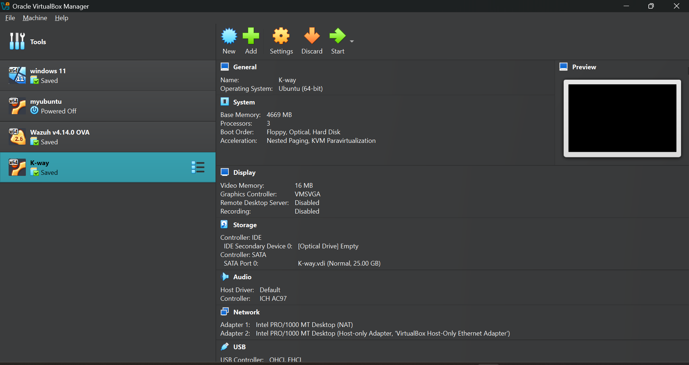
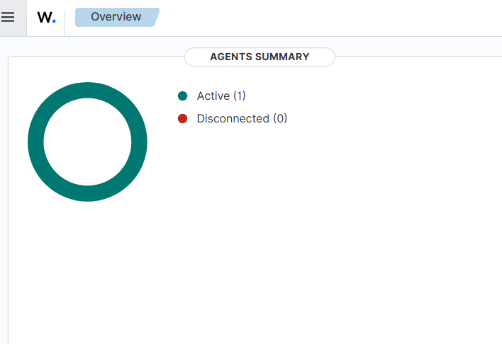
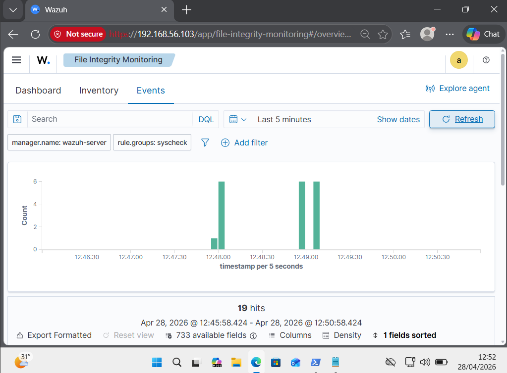
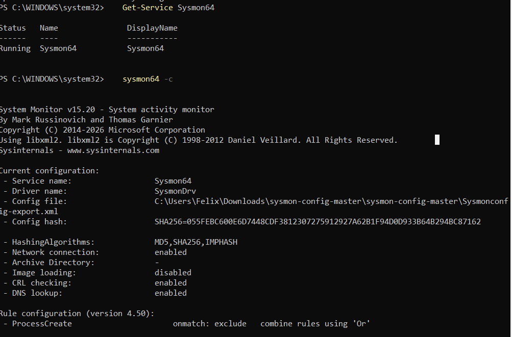
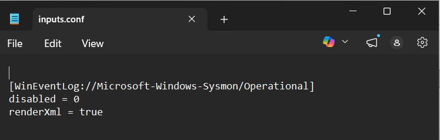
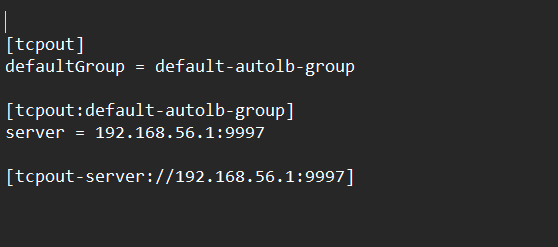
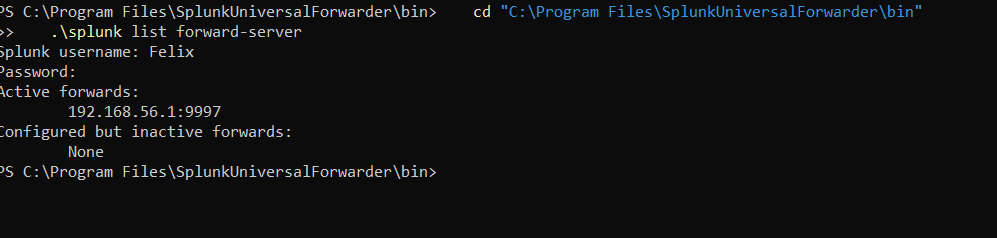
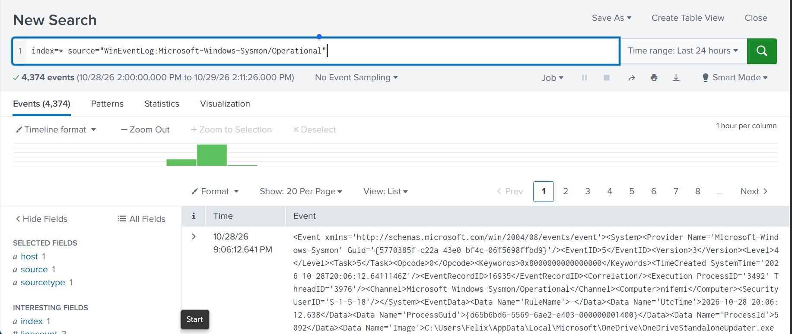

01:Home SOC Lab
A virtualised Security Operations Centre lab I built from scratch for hands-on detection and monitoring practice. Endpoint telemetry is collected with Sysmon, monitored with Wazuh, and forwarded to Splunk with the Universal Forwarder.
Tools used
Area	Tool
Virtualisation	Oracle VirtualBox
SIEM / HIDS	Wazuh v4.14.0 (OVA)
Endpoint telemetry	Sysmon v15.20 with the SwiftOnSecurity config
Log forwarding	Splunk Universal Forwarder
Log search and analysis	Splunk
Endpoint OS	Windows 11
Lab architecture
```
Windows 11 VM (Sysmon) --> Splunk Universal Forwarder --> Splunk (port 9997)
        |
        +--> Wazuh agent --> Wazuh server (OVA)
```
All VMs are connected on a VirtualBox host-only network (`192.168.56.0/24`), with a NAT adapter for internet access.
---
1. Virtual machines
The lab runs on VirtualBox. It includes a Windows 11 endpoint, an Ubuntu VM, and the Wazuh v4.14.0 OVA as the SIEM server. Each VM has a NAT adapter for internet access and a host-only adapter for lab traffic.

2. Wazuh: agent status
The Wazuh dashboard shows the agent registered and active, with no disconnected agents.

3. Wazuh: file integrity monitoring
File Integrity Monitoring (the `syscheck` rule group) reports file changes on the monitored endpoint. This capture shows 19 events in a 5-minute window.

4. Sysmon with the SwiftOnSecurity configuration
Sysmon is installed as a service and loaded with the SwiftOnSecurity configuration.
Checks run in PowerShell:
```powershell
Get-Service Sysmon64
sysmon64 -c
```
The output confirms:
The `Sysmon64` service is Running
Sysmon v15.20 is loaded with the SwiftOnSecurity config file
Hashing: MD5, SHA256, IMPHASH
Network connection logging is enabled

5. Splunk Universal Forwarder: collecting Sysmon logs
`inputs.conf` tells the forwarder to collect the Sysmon Operational event log:
```ini
[WinEventLog://Microsoft-Windows-Sysmon/Operational]
disabled = 0
renderXml = true
```

6. Splunk Universal Forwarder: sending to Splunk
`outputs.conf` sends the logs to the Splunk receiving port `9997`:
```ini
[tcpout]
defaultGroup = default-autolb-group

[tcpout:default-autolb-group]
server = 192.168.56.1:9997

[tcpout-server://192.168.56.1:9997]
```

7. Verifying the forward connection
```powershell
cd "C:\Program Files\SplunkUniversalForwarder\bin"
.\splunk list forward-server
```
The forward server is listed under Active forwards, with no inactive forwards.

8. Sysmon events arriving in Splunk
Search used:
```spl
index=* source="WinEventLog:Microsoft-Windows-Sysmon/Operational"
```
This returned 4,374 Sysmon events in 24 hours, confirming the full pipeline works from Windows 11, through Sysmon and the Universal Forwarder, into Splunk.

---
What I learned
How to deploy Sysmon with a community-maintained config to get high-quality endpoint telemetry
How the Splunk Universal Forwarder's `inputs.conf` and `outputs.conf` control what is collected and where it is sent
How to verify a log pipeline end to end: service running, forward active, events searchable
How Wazuh agents and file integrity monitoring work
Next steps
Simulate attacks from Kali Linux and build detections in Wazuh and Splunk
Write Splunk alerts and dashboards for Sysmon events
Map detections to MITRE ATT&CK
